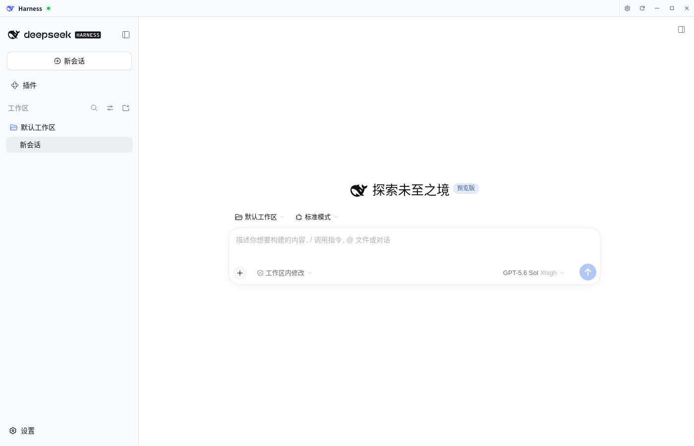
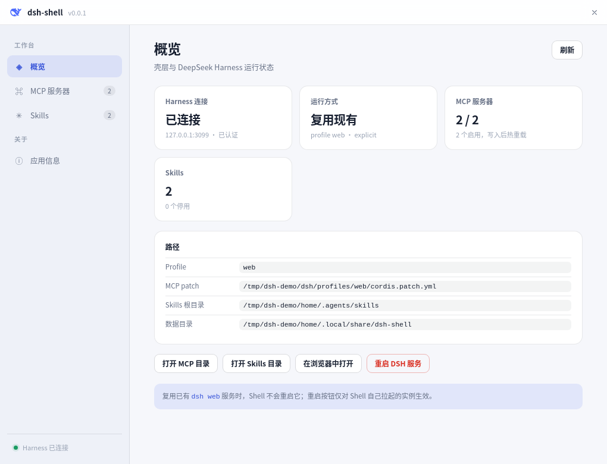
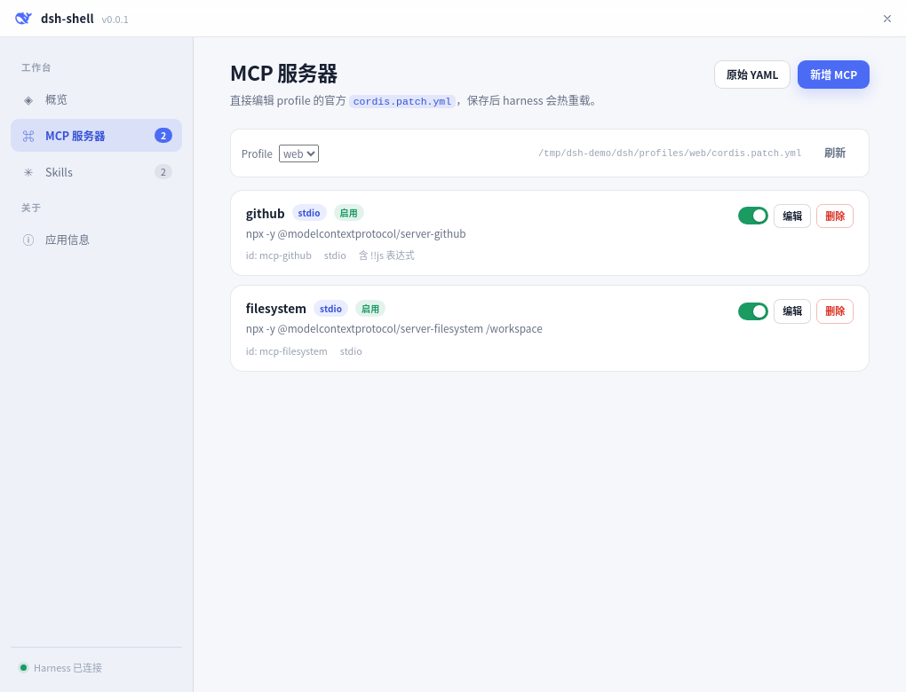
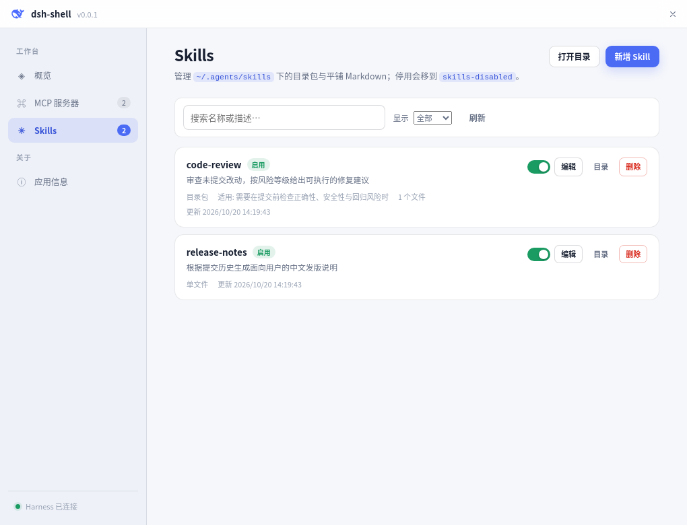

<div align="right">

**English** · [简体中文](README.md)

</div>

<p align="center">
  
</p>

<h1 align="center">dsh-shell</h1>

<p align="center"><b>A desktop shell for DeepSeek Harness</b> · frameless window, tray residency, MCP and Skills management</p>

<p align="center">
  
  
  
  
</p>

<p align="center">
  
</p>

## ✨ Features

- 🪟 **Frameless native shell** — self-drawn 34 px title bar and eight resize handles; works on X11, Wayland and Windows.
- 🔁 **Reuse before spawn** — takes over an existing `dsh web` on `127.0.0.1:3080` (token-auth included), otherwise spawns one, falling back to `npx` / `pnpm` / `npm`.
- 🧩 **MCP editor** — edits the official `cordis.patch.yml` while preserving comments, unknown keys and `!!js` expressions; form and raw YAML modes.
- 🛠️ **Skills manager** — directory bundles and flat Markdown, with enable/disable, frontmatter editing and safe deletion.
- 🖥️ **Tray resident** — show/hide, reload, open in browser, restart DSH, quit; degrades to close-to-quit when no tray exists.
- 📦 **One-click packaging** — Nuitka onefile: DEB on Linux, a single EXE on Windows.

## 🖼️ Screenshots

<p align="center">
  
</p>

| MCP servers | Skills |
| :---: | :---: |
|  |  |

## 🚀 Quick start

Requires **Python 3.12** and [uv](https://docs.astral.sh/uv/):

```bash
uv sync --group dev

uv run main.py              # frameless window + tray
uv run main.py --debug      # verbose logs + CDP on 127.0.0.1:9229
uv run main.py --no-tray    # run without the tray host (debuggers)
uv run main.py --smoke-test # print runtime / MCP / skills status
```

Reuse a running server, or point the shell at an explicit URL:

```bash
uv run main.py --url "http://127.0.0.1:3080/?token=..."
```

### ⌨️ Common flags

| Flag | Description |
| --- | --- |
| `--url URL` | Reuse an explicit `dsh web` (token URLs supported) |
| `--port PORT` | Preferred `dsh web` port, default `3080` |
| `--profile NAME` | Harness profile, default `web` |
| `--no-reuse` | Never probe or reuse an existing service |
| `--no-spawn` | Never start `dsh`; require `--url` or an existing service |
| `--no-tray` | Run the webview without the tray host process |
| `--debug` | Verbose logs and remote debugging on port `9229` |
| `--smoke-test` | Print runtime / MCP / skills status and exit |

> [!TIP]
> On a `401`, the shell looks the token up in the environment, `runtime.json`, supervisor logs, `/proc` and `journalctl` before reusing the server.
>
> Logs live in `~/.local/share/dsh-shell/logs/dsh-shell.log` (`%APPDATA%` on Windows).

## 🧩 MCP

The MCP surface of Harness is the profile patch layer:

```text
$DSH_HOME/profiles/<profile>/cordis.patch.yml
```

```yaml
- id: mcp-github
  name: '@deepseek-ai/dsh-mcp-client'
  config:
    serverName: github
    transport: stdio
    command: npx
    args: ['-y', '@modelcontextprotocol/server-github']
    env:
      GITHUB_TOKEN: !!js process.env.GITHUB_TOKEN
```

The shell preserves comments and untouched `!!js` tags, validates transports and timeouts, rejects duplicate ids / `serverName` values, and writes atomically with a `.bak` copy. The `web` profile uses `patchReload: live`, so saves apply immediately.

## 🛠️ Skills

Harness scans:

```text
~/.agents/skills/<name>/SKILL.md   # bundle
~/.agents/skills/<name>.md         # flat file
```

Frontmatter needs `name` (kebab-case) and `description`; `whenToUse`, `disable-model-invocation` and `user-invocable` are optional. Disabling moves an entry to `skills-disabled/`; deleting moves it to `~/.local/share/dsh-shell/trash/skills/` for manual recovery.

## 📦 Build

| Platform | Command | Artifacts |
| --- | --- | --- |
| Linux | `./build_linux.sh` | `dist/dsh-shell`, `dist/dsh-shell_<version>_amd64.deb` |
| Windows | `build_windows.bat` | `dist/dsh-shell.exe` |

Pushing a `v*` tag runs GitHub Actions: version check, lint, tests, builds all three artifacts and publishes a release.

```bash
git tag v0.0.1
git push origin v0.0.1
```

Regenerate icons from `assets/icon-source.png`:

```bash
uv run python scripts/make_icons.py
```

## 🧪 Quality

```bash
uv run pytest
uv run ruff check .
```

## 📁 Layout

```text
main.py                 entrypoint, single instance, tray host, child process
dsh_shell/
  dsh_runtime.py        reuse / probe / token discovery / spawn / stop
  mcp_config.py         cordis.patch.yml CRUD + validation
  skills.py             ~/.agents/skills discovery + CRUD
  api.py                pywebview JS API
  webview_app.py        windows, chrome injection, command loop
  tray.py / single_instance.py / paths.py
ui/                     chrome injection and settings UI
tests/                  pytest regression suite
docs/screenshots/       README screenshots
```
